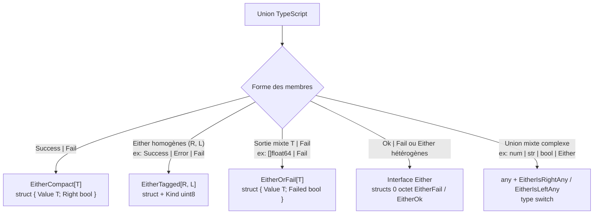

# 08 · Approche hybride : structs spécialisées et dépliage à plat

Branche dédiée : [`feature/hybrid-either-and-pipe`](https://github.com/Froggys974/croco-ecole-go-2026/tree/feature/hybrid-either-and-pipe) (explorée en parallèle de `develop`).

## La problématique

Traduire toutes les unions TypeScript avec une seule représentation Go impose toujours un compromis :

- Tout passer par une **interface `Either`** oblige Go à allouer sur le tas (*boxing*) dès qu'une fonction dépasse le budget d'inlining, et force une assertion `GetValue().(T)` à chaque lecture.
- Tout passer par une **struct universelle (`Value` 64 octets)** copie 64 octets à chaque passage, perd le typage statique dès qu'un objet ou un tableau entre dans une union (`object any`), et alourdit `MarshalJSON`.

Comment garder un typage Go natif, supprimer les allocations sur le tas et produire un code assez court pour être inliné par Go ?

## La solution

Au lieu d'une boîte unique, le transpileur inspecte les membres de l'union à la traduction et choisit la représentation Go la plus légère et la plus précise possible :

Quatre choix structurent cette architecture :

- **Structs spécialisées sans boxing :** les cas courants (`Success<T> | Fail`, unions `Either` homogènes, sorties `T | Fail`) vivent sur la pile avec lecture directe `.Value` ou `.RightValue`, sans assertion de type.
- **Coercition directe aux frontières (`coerce.ts`) :** quand un `return DEither.success(x)` cible un contrat `EitherCompact[T]` ou `EitherTagged[R, L]`, l'appel est directement réécrit en `EitherCompactSuccess[T](x)` sans struct intermédiaire.
- **`pipe` hybride et `whenIsRight` à plat :** `DCommon.pipe` est déroulé récursivement via `Callable` (avec repli sur `typeChecker.getTypeAtLocation` quand l'inférence générique échoue). Chaque `whenIsRight` est injecté à plat (`if res.IsRight() { ... } else { ... }`) — **aucune closure, aucune IIFE** — pour rester sous le seuil d'inlining Go (80 noeuds AST).
- **Parité JSON et `DCommon.print` :** `EitherFail` et `EitherOk` font 0 octet (`struct{}`) et renvoient un `[]byte` JSON préformaté sans réflexion. `CommonPrint[T]` utilise un `switch` par type (`string` brut, `JSUndefined` -> `"undefined"`, JSON pour le reste) pour garantir la parité avec Node et Bun.

## Les résultats mesurés

Sur la suite portable `/benchmark` (15 scénarios `p00`–`p04` et `s01`–`s10`, 1 000 000 opérations par cas sous Docker, parité vérifiée entre Node, Bun et Go) :

| Branche | Gain moyen vs Node | Gain moyen vs Bun | Allocations Go | Scénarios supportés |
| :--- | :---: | :---: | :---: | :---: |
| **`develop`** (`Value` 64B + IIFE) | **40,9x** | **2,1x** | 0 B/op | 12 / 15 |
| **`hybride`** (structs spécialisées + pipe à plat) | **430,6x** | **30,6x** | **0 B/op** | **15 / 15** |

Pour consulter le détail complet (métriques P50/P95/P99 et code Go généré fichier par fichier), télécharger et ouvrir les rapports HTML interactifs :
- [report-hybrid.html](report-hybrid.html) (approche hybride)
- [report-develop.html](report-develop.html) (branche `develop`)

## Outils Go et prolongements

- **Audit compilateur (`-gcflags="-m"`) :** utilisé à chaque itération pour vérifier l'absence d'échappement sur le tas et le respect du budget d'inlining Go.
- **Optimisation binaire :** `-ldflags="-s -w"` réduit le binaire de **-34,3 %**, et le PGO natif (`-pgo`) apporte **+6,5 %** en médiane.
- **Suite (`05`–`10`) :** Sum-Types sur mesure pour les unions à 3+ types disparates, spécialisation `int64` sur `%`, `Tuple2..Tuple8` contiguës et `Promise[T]` concurrente sur goroutine + `chan struct{}`.

Voir les [exemples](EXEMPLES.md) et les [pistes](PISTES.md).

## Où dans le code (`feature/hybrid-either-and-pipe`)

`sharedDependency/either/` (`compact.ts`, `tagged.ts`, `orFail.ts`, `unit.ts`, `anyChecks.ts`), `transformers/type/union/`, `transformers/common/coerce.ts`, `transformers/common/callable.ts`, `transformers/duplojs/common/pipe.ts`, `transformers/duplojs/either/whenIsRight.ts`, `transformers/shared/expressionPurity.ts`.
