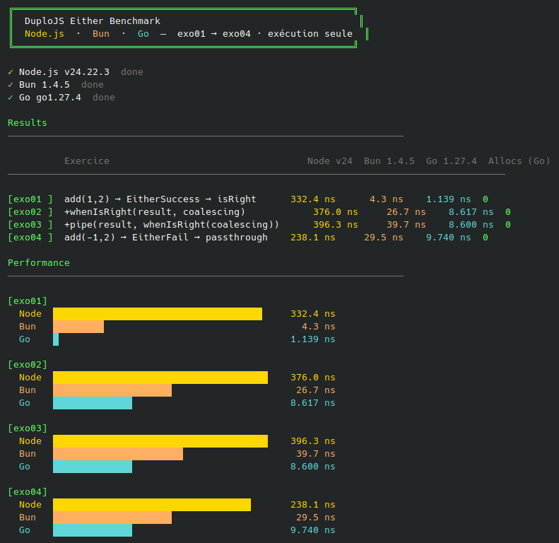

# Transpileur TypeScript + DuploJS → Go : le rendu

Un dossier par problématique. Chacun contient :

- `README.md` : la problématique et la solution retenue, en court ;
- `HISTORIQUE.md` : les pistes explorées, ce qui a été choisi, et pourquoi ;
- `EXEMPLES.md` : du TypeScript et du Go **réécrits à la main** pour montrer la logique.
  Ce n'est pas la sortie brute du transpileur : les noms sont lisibles, le préfixe
  `shard_dependencies.` est retiré, et `...` remplace ce qui n'aide pas à comprendre.

Le dossier 07 n'a qu'un `README.md` : il décrit la méthode commune à tous les autres.

## Le découpage

| Dossier | Problématique | Exos |
| --- | --- | --- |
| [01-expressions-et-appels](01-expressions-et-appels/) | Traduire `number`, une addition, `-1`, et un appel de fonction en gardant l'ordre d'évaluation de JS | 00, 04 |
| [02-unions-et-either](02-unions-et-either/) | Représenter en Go une valeur qui peut avoir plusieurs formes (`A \| B`, `Success \| Fail`) | 01, 04 |
| [03-fonctions-en-argument](03-fonctions-en-argument/) | Traduire un appel qui reçoit une fonction (`whenIsRight(result, coalescing)`) | 02 |
| [04-pipe](04-pipe/) | Traduire une composition d'étapes (`DCommon.pipe`) | 03 |
| [05-issues-multiples](05-issues-multiples/) | Traiter chaque issue d'un résultat (`whenIsRightOtherwise`) avec des fonctions écrites sur place | 05 |
| [06-collections](06-collections/) | Transformer chaque élément d'un tableau (`DArray.map`, `DString.to`) | 05 |
| [07-methode-et-verification](07-methode-et-verification/) | Comment on a décidé, mesuré et vérifié | toutes |

## Le fil conducteur

Une seule idée revient partout : **décider à la traduction ce que JavaScript décide à l'exécution.**
Le checker TypeScript connaît le type de chaque valeur, la forme de chaque appel et les étapes de
chaque pipe. Le Go produit ne garde que ce qui dépend vraiment de la valeur.

| JavaScript se demande, à l'exécution… | …on le sait à la traduction | Il reste dans le Go |
| --- | --- | --- |
| « quel est le type de cette valeur ? » | le type de chaque `return` | une étiquette dans la boîte `Value` |
| « `coalescing(x)` : `x` est-il un tableau ? » | le type Go le dit | rien : `[]float64{x}` |
| « forme complète ou curryfiée ? » | on compte les arguments | rien |
| « quelle est la prochaine fonction du pipe ? » | les étapes sont écrites | un appel par étape |
| « est-ce un Right ? » | — | `if EitherIsRight(e)` |

## Résultat

- Exos 00 à 05 : **sortie Go identique à celle de TypeScript**, au caractère près.
- Corpus de tests différentiels : **61 cas conformes sur 64**. Les 3 écarts sont expliqués dans
  [07-methode-et-verification](07-methode-et-verification/README.md#limites-connues).

## Benchmark

Comparaison des performances entre Node.js, Bun et Go sur les exercices exo01 → exo04 (exécution seule).

