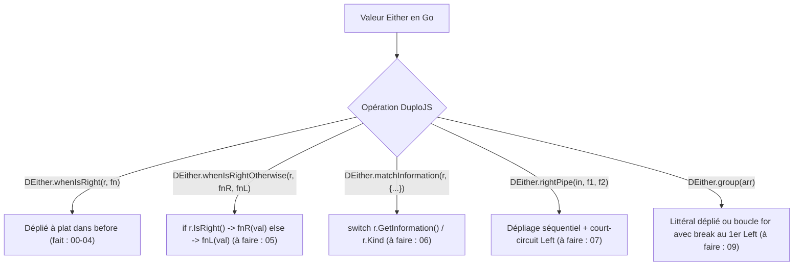

# 01 — Stratégies TS vers Go, `DEither` et `@duplojs/server`

> Référence publique de l'architecture hybride déjà implémentée (`00`–`04`) : [rendu/08-approche-hybride/README.md](../../rendu/08-approche-hybride/README.md).
> Feuille de route publique pour `06`–`10` : [rendu/09-vision-long-terme/README.md](../../rendu/09-vision-long-terme/README.md).

## 1. Les 4 familles d'écarts et les 5 leviers de transformation

| Famille d'écarts | Problème TS → Go | Levier principal à appliquer |
| :--- | :--- | :--- |
| **Types** | Unions discriminées (`Success \| Fail`), narrowing contextuel, `number` vs `int`/`float64` | **Spécialiser** via `TypeChecker` TS au point d'usage exact |
| **Objets & Données** | Tuples `[a, b, c]`, objets littéraux de handlers, `null`/`undefined` | **Traduire** en structs typées (`Tuple3`, `JSNull`) plutôt qu'en `map[string]any` |
| **Construction** | Appels top-level, fonctions comme valeurs, modules par fichier | **Réorganiser** (top-level → `func init()`, fléchées → `FunctionLiteral`, packages relatifs `Sourced_...`) |
| **Exécution** | Ternaire `a ? b : c`, destructuring de paramètres, `pipe`, `async`/`await` | **Réorganiser** (`before`) + **Injecter** (`shard_dependencies`) + **Cadrer** (`notSupport`) |

---

## 2. Anatomie de `@duplojs/lang/either` (`DEither`)

Dans `@duplojs/lang@0.1.0-beta.11`, tout `Either` est un objet marqué par des clés `Kind` (`@duplojs/lang/kind/@DuplojsLangEither/...`) portant un statut (`right` ou `left`), une `information` littérale et une `value`.

| Type TS | Variante de base | `information` | `value` | Rôle |
| :--- | :--- | :--- | :--- | :--- |
| `Right<Info, V>` | Base succès/état | `Info` (`string`) | `V` | Résultat nominal |
| `Left<Info, V>` | Base échec/absence | `Info` (`string`) | `V` | Échec contextualisé |
| `Success<V>` | `Right<"success", V>` | `"success"` | `V` | Succès standard (Projets `00`–`10`) |
| `Ok` | `Right<"ok", void>` | `"ok"` | `undefined` | Succès sans valeur |
| `Some<V>` | `Right<"some", V>` | `"some"` | `V` | Valeur présente (`Maybe<V>`) |
| `Result<Info, V>` | `Right<Info, V>` | `Info` | `V` | État métier neutre |
| `Fail` | `Left<"fail", void>` | `"fail"` | `undefined` | Échec générique sans payload |
| `Error<V>` | `Left<"error", V>` | `"error"` | `V` | Échec standard avec payload |
| `None` | `Left<"none", null>` | `"none"` | `null` | Absence (`Maybe<V>`) |
| `SafeCallbackSuccess<V>` | `Right<"safe-callback-success", V>` | `"safe-callback-success"` | `V` | Capture `try/catch` réussie |
| `SafeCallbackError` | `Left<"safe-callback-error", unknown>` | `"safe-callback-error"` | `unknown` | Exception JS convertie en `Left` |

---

## 3. Représentation Go hybride de `DEither` (en place sur `hybrid-arch`)

L'architecture finale spécialise la représentation Go selon la forme exacte de l'union (détails et benchmarks dans [rendu/08-approche-hybride/PISTES.md](../../rendu/08-approche-hybride/PISTES.md)) :

| Forme d'union TS | Représentation Go | Caractéristique clé |
| :--- | :--- | :--- |
| `Success<T> \| Fail` | `EitherCompact[T]` | `{ Value T; Right bool }` (16B sur pile, 0 alloc, lecture directe `.Value`) |
| `Either` homogènes (ex: `Success \| Error \| Fail`) | `EitherTagged[R, L]` | Struct pile + `Kind uint8` (0 alloc, lecture `.RightValue` / `.LeftValue`) |
| Sortie mixte `T \| Fail` (ex: `[]float64 \| Fail`) | `EitherOrFail[T]` | `{ Value T; Failed bool }` (supprime le boxing `any` hors `whenIsRight`) |
| `Ok \| Fail` ou `Either` hétérogènes | Interface `Either` | Singletons 0 octet `EitherFail{}` / `EitherOk{}` + JSON préformaté |
| Unions mixtes à 3+ types disparates | `any` (+ future **Sum-Type 32B**) | Discriminé par `EitherIsRightAny` / `EitherIsLeftAny` (`type switch`) |

### Flux d'opérations pour la suite (`05`–`10`)

---

## 4. Ouverture : `@duplojs/server`

Aucun des exercices `01`–`10` n'importe `@duplojs/server` ; ils reposent exclusivement sur `@duplojs/lang`. Pour une extension future vers `@duplojs/server`, voir la piste `net/http` + structs JSON dans [rendu/09-vision-long-terme/README.md](../../rendu/09-vision-long-terme/README.md#ouverture-vers-duplojsserver).
