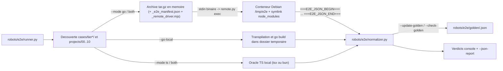

# Harnais E2E Opaque-Box (`robots/e2e/`)

## 1. Vue d'ensemble et philosophie

Le dossier `robots/e2e/` héberge la suite de tests de bout en bout (E2E) en approche **boite noire** (opaque-box) pour le transpileur TypeScript vers Go (`croco-ecole-go-2026`). Les cas de test sont pilotés exclusivement par les spécifications publiques de `@duplojs/lang` et la roadmap technique (`robots/docs/02-roadmap-exercices-05-a-10.md`), sans dépendance aux détails internes de `src/transpiler/`.

La suite est structurée en 4 niveaux progressifs :

| Tier | Objectif | Contenu |
|---|---|---|
| Tier 1 | Couverture fonctionnelle | Cas isolés par domaine (`DEither`, `DCommon`, `DArray`, `DString`, syntaxe/types TS) |
| Tier 2 | Limites, cas limites et rejets | Valeurs bornes (`-0`, division par zéro, UTF-8, court-circuit) et rejets hors périmètre (§4) |
| Tier 3 | Combinaisons pairwise | Interactions multi-domaines (tuples + pipes + async + matchers) |
| Tier 4 | Scénarios applicatifs et officiels | Applications multi-modules complètes et équivalence `projects/00`–`10` |

**Isolation vis-à-vis du coeur du dépôt :** `robots/e2e/` est ignoré par `oxlint.config.ts`, `tsconfig.json` et `SYNC_PATHS` (`robots/runner/remote.py`). Les fixtures de rejet volontairement invalides (par exemple `eval`, `throw`, `class`) peuvent donc coexister sans perturber `pnpm test:types` ni `robots/runner/lint.py`, et les dossiers `projects/00`–`10` restent intacts.

---

## 2. Architecture du harnais



---

## 3. Arborescence `robots/e2e/`

| Chemin | Rôle |
|---|---|
| `robots/e2e/runner.py` | Orchestrateur CLI dual-mode (`ts`, `go`, `both`), batch distant `tar.gz` via `stdin` et rapport JSON |
| `robots/e2e/normalizer.py` | Découpage contextuel de `stdout`, parseur `JsInspectParser` (`tsx`/`bun`/Go) et comparateur 8 règles |
| `robots/e2e/test_normalizer.py` | Tests unitaires (`unittest`) des 8 règles de normalisation, `00`–`10` et mocks `--mode go` |
| `robots/e2e/README.md` | Documentation d'utilisation et contrats d'interface du harnais |
| `robots/e2e/cases/tier1..4/` | Fixtures E2E organisées par tier (`case.json`, `tsconfig.json`, `index.ts`) |
| `robots/e2e/golden/` | Snapshots canoniques de référence (`<case_id>.json`, dont `proj_00.json`..`proj_10.json`) |

---

## 4. Référence CLI (`runner.py`)

Exécution : `uv run robots/e2e/runner.py [options]`

| Option | Valeurs / Type | Défaut | Description |
|---|---|---|---|
| `--tier` | `1\|2\|3\|4\|all` | `all` | Filtre les cas découverts sous `robots/e2e/cases/tier<N>/` |
| `--case` | `str` | `None` | Filtre par sous-chaine ou motif glob (`*` / `?`) sur l'identifiant |
| `--mode` | `ts\|go\|both` | `ts` | Exécute l'oracle TS, le pipeline Go contre golden, ou compare TS et Go en direct |
| `--runtime` | `node\|bun` | `node` | Runtime JS/TS (`tsx` sur Node ou `bun run`) pour TS et pour `bin/index.ts` |
| `--update-golden` | booléen | `False` | Écrit `robots/e2e/golden/<id>.json` pour les cas `positive` (interdit avec `--mode go` seul) |
| `--check-golden` | booléen | `False` | Vérifie la conformité aux snapshots golden (mutuellement exclusif avec `--update-golden`) |
| `--include-projects` | booléen | `False` | Inclut `projects/00`–`10` (`proj_00`..`proj_10`, `tier=4`) lorsque `--tier` vaut `all` ou `4` |
| `--projects-only` | booléen | `False` | Exécute uniquement `projects/00`–`10` (mutuellement exclusif avec `--include-projects`) |
| `--go-local` | booléen | `False` | Exécute transpilation et `go build` localement au lieu de `remote.py exec` |
| `--jobs` | `int >= 1` | `4` | Nombre de workers parallèles locaux (`ThreadPoolExecutor`) |
| `--remote-timeout` | `int >= 1` | `300` | Timeout global en secondes pour le batch SSH distant (`remote.py exec`) |
| `--json-report` | `Path` | `None` | Exporte le rapport structuré JSON (UTF-8, tabulations, fins de ligne LF) |

**Codes de sortie :**

| Code | Signification |
|---|---|
| `0` | Tous les cas sélectionnés ont réussi (`total > 0` et `failed == 0`) |
| `1` | Au moins un cas en échec, aucun cas sélectionné, ou erreur d'infrastructure distante |
| `2` | Combinaison d'arguments CLI invalide |

---

## 5. Commandes courantes

```bash
# Tests unitaires du normaliseur et des mocks du runner
uv run python -m unittest discover -s robots/e2e -p "test_*.py" -v

# Vérifications qualité Python (lint et typage strict)
uvx ruff check robots/e2e
uvx basedpyright robots/e2e

# Capturer les snapshots golden TS (Node/tsx) des exercices officiels 00-10
uv run robots/e2e/runner.py --projects-only --mode ts --runtime node --update-golden

# Vérifier l'équivalence des snapshots 00-10 sous Node et Bun
uv run robots/e2e/runner.py --projects-only --mode ts --runtime node --check-golden
uv run robots/e2e/runner.py --projects-only --mode ts --runtime bun --check-golden

# Exécuter les exercices 00-10 en Go sur croco-go-runner contre golden
uv run robots/e2e/runner.py --projects-only --mode go --runtime node

# Comparer en direct TS et Go sur tous les tiers + projets officiels avec rapport JSON
uv run robots/e2e/runner.py --include-projects --mode both --json-report robots/e2e/last-report.json
```

---

## 6. Format d'un cas de test (`case.json`)

Chaque cas réside dans `robots/e2e/cases/tier<N>/<case_id>/` et contient au minimum `case.json`, `tsconfig.json` et le fichier d'entrée (par défaut `index.ts`).

| Champ | Type | Règle |
|---|---|---|
| `id` | `string` | Non vide, identique au nom du dossier `<case_id>` |
| `tier` | `1 \| 2 \| 3 \| 4` | Cohérent avec le dossier parent `tier<N>` |
| `feature` | `string` | Domaine fonctionnel couvert (ex. `DEither.success`) |
| `kind` | `"positive" \| "reject"` | Cas nominal/métier ou rejet attendu du transpileur |
| `entry` | `string` | Fichier TypeScript d'entrée contenu dans le dossier du cas |
| `description` | `string` | Description concise du comportement vérifié |
| `expectRejectCategory` | `string \| null` | `null` si `positive` ; sinon une des 7 catégories de rejet §4 |

Exemple :

```json
{
	"id": "t1_either_success_01",
	"tier": 1,
	"feature": "DEither.success",
	"kind": "positive",
	"entry": "index.ts",
	"description": "DEither.success wraps numeric addition",
	"expectRejectCategory": null
}
```

**Comportement `positive` vs `reject` :**

1. Un cas `positive` exige `exitCode == 0` côté TS et Go (transpilation, `go build`, exécution) et une sortie canonique équivalente.
2. Un cas `reject` en `--mode ts` effectue une validation statique de la fixture (`PASS (reject-fixture-ready)`) sans exécuter JS ni créer de snapshot golden.
3. Un cas `reject` en `--mode go` ou `--mode both` exige que la transpilation (`bin/index.ts`) échoue (`transpileExit != 0`) avec `NotRightError` (ou `either-not-right-error`) et `transformation-error` ou `notfound-transformer` sur `stderr`.
4. Les 7 catégories reconnues pour `expectRejectCategory` sont : `meta-js`, `open-objects-any`, `exceptions`, `oop-this`, `type-level`, `unbounded-concurrency`, `runtime-apis`.

---

## 7. Règles de normalisation (TS vs Go)

| # | Règle | Détail |
|---|---|---|
| 1 | Nettoyage texte | Conversion `\r\n` et `\r` vers `\n`, suppression des séquences ANSI SGR/OSC, préservation UTF-8 |
| 2 | Découpage en blocs | Suivi contextuel de la profondeur `{...}` / `[...]` hors chaines ; les lignes scalaires à profondeur 0 conservent les espaces/tabulations initiaux sans interpréter `{`, `[` ou `'` |
| 3 | Parsing canonique | `json.loads` (rejetant `NaN`/`Infinity`) puis parseur récursif `JsInspectParser` (`tsx` quotes simples, paires de surrogates UTF-16, `bun` virgules finales, chaines brutes top-level, scalaires) |
| 4 | `JSUndefined` sur `Either/value` | Quand TS produit `undefined` (sérialisé `{"__e2e_undefined__": true}` en golden), Go peut émettre `null` ou omettre la clé (`omitzero`) ; `null` explicite exige `null` |
| 5 | Nombres `float64` et booléens | Test `bool` avant `(int, float)`, `-0 == 0`, tolérance `1e-12`, rejet `NaN`/`Infinity`, distinction stricte `"0"` vs `"-0"` dans les chaines |
| 6 | Tableaux vides | `[]` est strictement distinct de `null` (rejet des slices Go `nil`) |
| 7 | Équivalence `TupleN` | Accepte `[v0, v1, ...]` ou `{"V0": v0, "V1": v1, ...}` si et seulement si les clés sont exactement `V0..VN-1` (`N >= 1`) |
| 8 | Objets et diagnostic | Comparaison insensible à l'ordre des clés ; rapport structuré (`DiffItem`, `ComparisonResult`) avec chemin JSONPath |

**Convention Tier 2–4 pour les chaines top-level ambigues :** sur `stdout` brut, `DCommon.print(str)` sans enveloppe est ambigu lorsque `str` commence par `{` ou `[`, est entouré de guillemets doubles `"..."`, est multi-lignes (`\n`), ou vaut `""` (ligne vide). Les cas Tier 2–4 testant ces chaines doivent les encapsuler dans un tableau via `DCommon.print([str])`.

---

## 8. Dépannage et contraintes connues

| Symptôme / Contrainte | Cause | Parade / Action |
|---|---|---|
| Timeout SSH sur `croco-go-runner` | Hôte `192.168.100.136:2222` injoignable ou batch volumineux (`> 300s`) | Vérifier le runner distant/VPN, augmenter `--remote-timeout` (ex. `--remote-timeout 900`), ou exécuter `--mode ts` / les tests mockés |
| Chaines top-level ambigues (`{...}`, `"..."`, `\n`, `""`) | `console.info` / `DCommon.print` émet des chaines brutes non quotées sur `stdout` | Envelopper la chaine testée dans un tableau (`DCommon.print([str])`) dans les cas Tier 2–4 |
| `missingProject` avec `--go-local` sous Windows | Conflit de chemins `DPath` vs `tsgo` sur Windows natif | Utiliser `--mode go` via le conteneur Debian `croco-go-runner` (ou exécuter sous Linux/WSL) |
| Encodage console Windows (`cp1252`) | Décodage implicite des sous-processus Python | Le harnais force `utf-8` (`errors="replace"`) sur tous les flux binaires |
| Mémoire limitée (`931 MiB` RAM) du conteneur | `tsgo` + `go build` parallèles peuvent provoquer un OOM | `_remote_driver.mjs` exécute les cas séquentiellement dans `/tmp/e2e` en un seul batch SSH |
| Dépendance `python3` absente dans le conteneur | Le `Dockerfile` embarque `node` 24, `bun` et `go`, pas `python3` | Le harnais injecte `_remote_driver.mjs` (Node 24 pur) directement dans l'archive `.tar.gz` |
